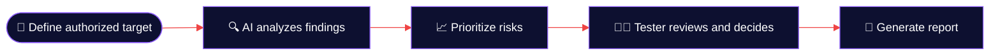

<div align="center">


<br/>


</div>


## 👋 Overview

**AI Red Team Assistant** is an intelligent co-pilot for **authorized security testing**. It helps testers analyze vulnerabilities, prioritize risks, understand findings, and generate professional security reports with AI-assisted workflows.

The tester always stays in control. The assistant explains and recommends, it never attacks on its own.

<div align="center">


</div>


## 🖥️ Product Preview

<div align="center">


</div>


## ✨ Features

<div align="center">


</div>

### 📊 Risk at a Glance

<div align="center">


</div>


## 🔄 How It Works



<!-- TODO: adjust the steps if your real workflow differs -->


## 🛠️ Tech Stack

<div align="center">


</div>

<!-- TODO: keep only the icons you actually used (e.g. react, ts, fastapi, nodejs) -->

## ⚙️ Installation

```bash
git clone https://github.com/martin8281/ai-red-team-assistant.git
cd ai-red-team-assistant
pip install -r requirements.txt
python app.py
```

<!-- TODO: fix repo name and run commands to match your project -->

## 📁 Project Structure

```text
ai-red-team-assistant/
├── assets/
│   ├── banner.svg
│   ├── features.svg
│   ├── severity.svg
│   ├── principles.svg
│   ├── divider.svg
│   └── preview.png         ← product screenshot
├── app.py
├── requirements.txt
└── README.md
```


## ⚠️ Disclaimer

> This project is for **authorized security testing and educational use only**. Use it only on systems you own or have written permission to test. The author is not responsible for misuse.

## 👤 Author

<div align="center">

**Martin Thomas** · M.Sc. AI & Cyber Security, CHRIST (Deemed to be University)

[](https://linkedin.com/in/martin-thomas)
[](https://github.com/martin8281)

⭐ *If you find this useful, give it a star.*


</div>
