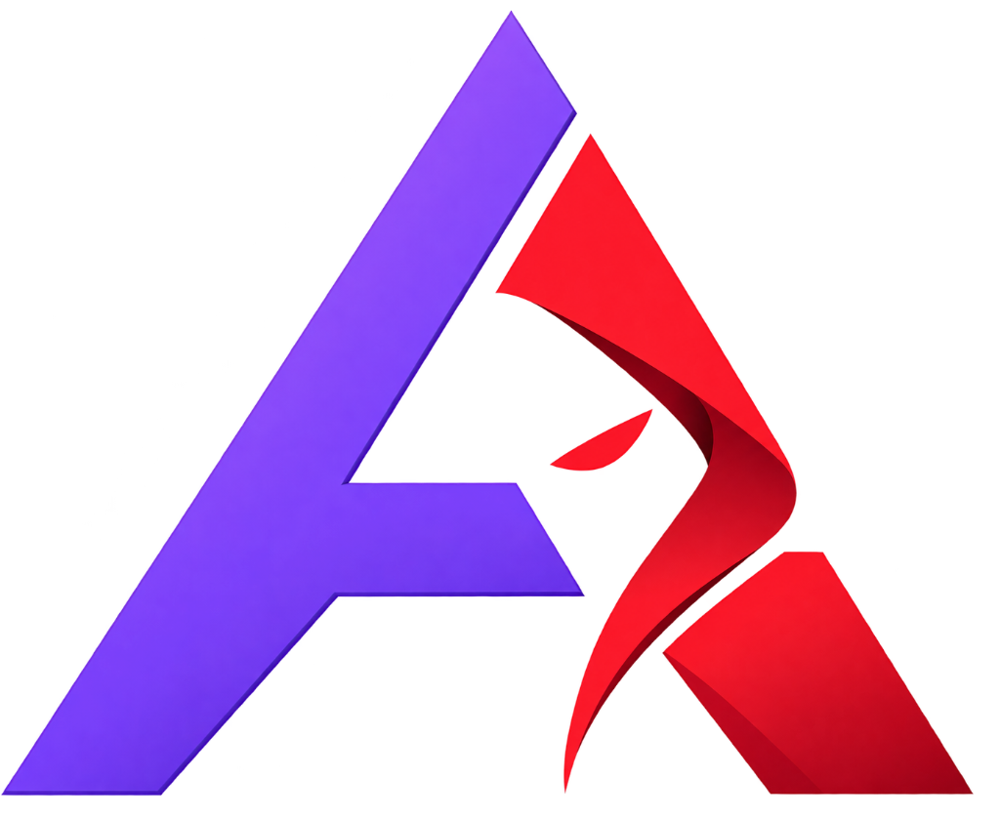
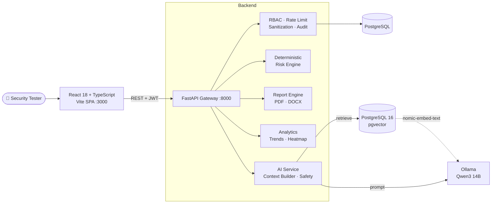

<div align="center">



# AI <span style="color:#e11">RED</span> TEAM ASSISTANT

### Your intelligent co-pilot for authorized security testing

An on-premises, **human-in-the-loop** AI platform that helps security testers analyze vulnerabilities, prioritize risk, understand findings, and generate professional reports.

<br/>


<br/>

[Features](#-key-features) · [Screenshots](#-screenshots) · [Architecture](#-architecture) · [Quick Start](#-quick-start) · [Testing](#-testing) · [Docs](#-documentation)

<br/>


</div>

---

## 📖 About the Project

**AI Red Team Assistant** supports professional security testers across the full engagement lifecycle: **scoping → finding discovery → risk calibration → remediation tracking → report delivery**.

It is a *co-pilot*, not an autopilot. The AI explains, correlates, and recommends. The human tester stays in control of every decision.

### 🛡️ Core Principles

| Principle | What it means |
| :--- | :--- |
| 🧑‍💻 **Human-in-the-Loop** | The AI never runs attacks, exploits targets, or changes project records without explicit tester approval. |
| 🧮 **Deterministic Risk Scoring** | Risk scores (0–100) come from an explainable, configurable math engine, not from LLM guesses. |
| 📚 **Grounded Answers (RAG)** | Responses are grounded in indexed standards (OWASP, CWE, NIST, CVSS) stored in `pgvector`, with citations. |
| 🔒 **100% On-Premises** | Inference runs locally through Ollama. No customer data goes to commercial cloud AI APIs. |

---

## ✨ Key Features

<table>
<tr>
<td width="50%" valign="top">

### 🤖 AI Security Co-Pilot
- Chat with the AI in **General** or **Entire Project** context, or scoped to a single **Finding**, **Scope Boundary**, or **Risk Profile**
- Attach forensic evidence: logs, PCAP, code, PDFs, archives
- Correlates `auth.log`, `nmap` scans, and traffic traces
- Suggests **controlled, non-destructive** validation tests
- Structured JSON responses with honest-uncertainty fallbacks
- Session history with per-project conversations

</td>
<td width="50%" valign="top">

### 🧮 Deterministic Risk Engine
- Weighted multi-factor model: **Impact (35%)**, **Likelihood (30%)**, **Asset Criticality (20%)**, **Exploitability (15%)**
- Scores map to **Critical / High / Moderate / Low** and **P1–P4** priorities
- All weights and thresholds live in one config file
- Highest-impact threat and ranked threat vectors per engagement
- **"Explain Risk Posture with AI"** for plain-language reasoning

</td>
</tr>
<tr>
<td width="50%" valign="top">

### 📁 Projects & Scope Management
- Engagement containers with client, type, dates, and scope
- Live progress, finding count, critical count, and risk score per project
- Status workflow: **Draft → Active → On Hold → Completed → Archived**
- Scope boundary enforcement and asset inventory
- Project file manager with preview

</td>
<td width="50%" valign="top">

### 🔎 Findings & Evidence
- Central repository of verified vulnerabilities with proof-of-concept evidence
- Filter by project, severity, status, and priority
- Remediation lifecycle: **Open → In Review → Remediation → Resolved**
- CWE classification, affected asset, and endpoint tracking
- Create findings directly from AI analysis

</td>
</tr>
<tr>
<td width="50%" valign="top">

### 📊 Analytics & Heatmap
- **5×5 threat risk heatmap** (Impact × Likelihood), click a cell to inspect threats
- 7 / 30 / 90-day and all-time views
- Remediation rate, SLA, and finding velocity trends
- AI-written posture summary with suggested prompt queries
- **Export to CSV**

</td>
<td width="50%" valign="top">

### 📄 Report Generation
- Audit-ready deliverables built from real scope, verified findings, and deterministic metrics
- Penetration Testing Report and other deliverable types
- Section editor, live preview, and versioning
- Export to **PDF** and **DOCX**

</td>
</tr>
<tr>
<td width="50%" valign="top">

### 🧠 Knowledge Base (RAG)
- Indexed sources: **OWASP Top 10**, **MITRE CWE**, **NIST SP 800-115**, **FIRST CVSS v3.1**, and internal red team playbooks
- `nomic-embed-text` embeddings stored in **PostgreSQL pgvector**
- Semantic vector search and an ingestion wizard for your own documents
- Citation verification against real document chunks

</td>
<td width="50%" valign="top">

### 🔐 Security & Governance
- **JWT authentication** with encrypted session handling
- **RBAC**: Admin, Security Tester, Reviewer, Viewer
- Object-level project authorization
- Rate limiting and enterprise security headers
- Input sanitization, prompt-injection defense, secret redaction
- SSRF blocklist, path traversal protection, audit logging

</td>
</tr>
</table>

---

## 📸 Screenshots

<details open>
<summary><b>🔑 Sign in</b></summary>
<br/>

Role-based access with quick demo accounts for **Tester**, **Lead**, and **Viewer**.


</details>

<details open>
<summary><b>📈 Dashboard</b></summary>
<br/>

Engagement stats, an AI priority review queue, and an overall risk score with a risk vector breakdown.


</details>

<details open>
<summary><b>🤖 AI Security Co-Pilot</b></summary>
<br/>

Project-aware chat grounded in your evidence files, powered by a local Qwen3 14B model.


</details>

<details open>
<summary><b>📁 Projects & Scope</b></summary>
<br/>


</details>

<details open>
<summary><b>🔎 Findings & Evidence</b></summary>
<br/>


</details>

<details open>
<summary><b>⚠️ Risk Analysis</b></summary>
<br/>


</details>

<details open>
<summary><b>📊 Analytics & Heatmap</b></summary>
<br/>


</details>

<details open>
<summary><b>📄 Reports</b></summary>
<br/>


</details>

<details open>
<summary><b>🧠 Knowledge Base (RAG)</b></summary>
<br/>


</details>

---

## 🏗️ Architecture



**How an AI answer is produced:**

1. The tester asks a question inside a project context.
2. The **Context Builder** gathers project scope, findings, and attached evidence.
3. Relevant standards are retrieved from **pgvector** (RAG).
4. The prompt is sanitized (injection defense and secret redaction) and sent to the **local Qwen3 14B**.
5. The response is parsed into a structured schema and returned with **verified citations**.
6. The tester reviews it. Nothing is acted on automatically.

---

## 🛠️ Tech Stack

| Layer | Technology |
| :--- | :--- |
| **Frontend** | React 18, TypeScript, Vite, Tailwind CSS, React Router, Recharts, Lucide |
| **Backend** | Python 3.11, FastAPI, Uvicorn, Pydantic, SQLAlchemy |
| **AI** | Ollama, Qwen3 14B, structured prompt management, safety guardrails |
| **Vector Store** | PostgreSQL 16, `pgvector`, `nomic-embed-text` embeddings |
| **Reports** | ReportLab (PDF), python-docx (DOCX) |
| **DevOps** | Docker, Docker Compose, Nginx, GitHub Actions CI |

---

## 🚀 Quick Start

### Prerequisites

- [Docker](https://www.docker.com/) and Docker Compose
- [Ollama](https://ollama.com/) installed on the host
- Node.js 20+ and Python 3.11+ (only for local development)

### Option 1: Docker Compose (recommended)

```bash
# 1. Clone the repository
git clone https://github.com/<your-username>/<your-repo>.git
cd <your-repo>

# 2. Configure environment variables
cp .env.example .env
#    then edit .env and change SECRET_KEY, JWT_SECRET and database passwords

# 3. Pull the local AI models
ollama pull qwen3:14b
ollama pull nomic-embed-text

# 4. Build and start everything (PostgreSQL + pgvector, FastAPI, React/Nginx)
docker compose up -d --build
```

| Service | URL |
| :--- | :--- |
| 🖥️ Web app | http://localhost:3000 |
| ⚙️ API docs (Swagger) | http://localhost:8000/docs |

### Option 2: Local development

**Frontend**

```bash
npm install
npm run dev          # http://127.0.0.1:3000
```

**Backend**

```bash
python -m venv venv
source venv/bin/activate          # Windows: .\venv\Scripts\activate
pip install -r requirements.txt
uvicorn backend.main:app --host 127.0.0.1 --port 8000 --reload
```

### Demo account

| Email | Password | Role |
| :--- | :--- | :--- |
| `tester@redteam.local` | `RedTeam@2026` | `SECURITY_TESTER` |

> ⚠️ Demo credentials are for local evaluation only. Never use them in a real deployment.

---

## 🧪 Testing

```bash
# Backend unit tests
python -m unittest discover backend/tests -v

# Security and AI guardrail suite
python run_all_tests.py

# Golden-project integration workflow
python test_golden_project.py

# End-to-end workflow demonstration
python test_e2e_workflow.py

# Frontend type check and production build
npm run build
```

**Coverage areas**

- ✅ Risk engine calculation and factor weights
- ✅ Intent classification and session memory
- ✅ Finding correlation and report generation
- ✅ SQL injection parameterization and XSS escaping
- ✅ SSRF blocklist (cloud metadata and private ranges)
- ✅ Path traversal defense
- ✅ Prompt-injection defense and structured response parsing

A **GitHub Actions** pipeline (`.github/workflows/ci.yml`) runs the backend tests, security suite, and frontend build on every push and pull request.

---

## 📂 Project Structure

```text
.
├── src/                    # React + TypeScript frontend
│   ├── components/         #   analytics · assistant · auth · dashboard · findings
│   │                       #   knowledge · projects · reports · risk · workspace
│   ├── pages/              #   Dashboard, Projects, Findings, Risk, Analytics, Reports, Knowledge…
│   ├── auth/               #   JWT auth context and services
│   └── ai/                 #   Client-side context builder and response parsing
├── backend/                # FastAPI backend
│   ├── ai/                 #   AI service, prompts, safety, intent classifier, session store
│   ├── analytics/          #   Finding, risk, remediation, and trend analytics
│   ├── api/                #   REST route handlers
│   ├── core/               #   RBAC, security, sanitization, scope enforcer, audit logger
│   ├── knowledge/          #   Embeddings, ingestion, pgvector store, RAG router
│   ├── pipeline/           #   File parsing and evidence correlation engine
│   ├── reports/            #   Report engine with PDF and DOCX generators
│   ├── risk/               #   Deterministic risk engine and config
│   ├── workspace/          #   Workflow engine, health evaluator, progress calculator
│   └── tests/              #   Unit tests
├── docs/                   # Architecture, API, test report, demo script and more
├── docker-compose.yml
├── Dockerfile.backend
├── Dockerfile.frontend
└── run_all_tests.py
```

---

## 📚 Documentation

| Document | Description |
| :--- | :--- |
| [Architecture](docs/ARCHITECTURE.md) | System design, data-flow diagrams, ER model, RAG pipeline |
| [API Documentation](docs/API_DOCUMENTATION.md) | Full REST endpoint reference |
| [Test Report](docs/TEST_REPORT.md) | QA matrix and results |
| [Backup Strategy](docs/BACKUP_STRATEGY.md) | PostgreSQL and pgvector backup and recovery |
| [Demo Script](docs/DEMO_SCRIPT.md) | Guided walkthrough |
| [Academic Report](docs/ACADEMIC_REPORT.md) | Project report |

---

## ⚖️ Ethical Use Notice

This software is built **only for authorized security testing, defensive evaluation, and academic research**. Testing systems without prior written permission is illegal. The platform follows non-destructive testing practices and requires explicit human confirmation for every action.

---

<div align="center">

**Built with 💜 for defenders who think like attackers.**

⭐ If you find this project useful, consider giving it a star.

</div>
