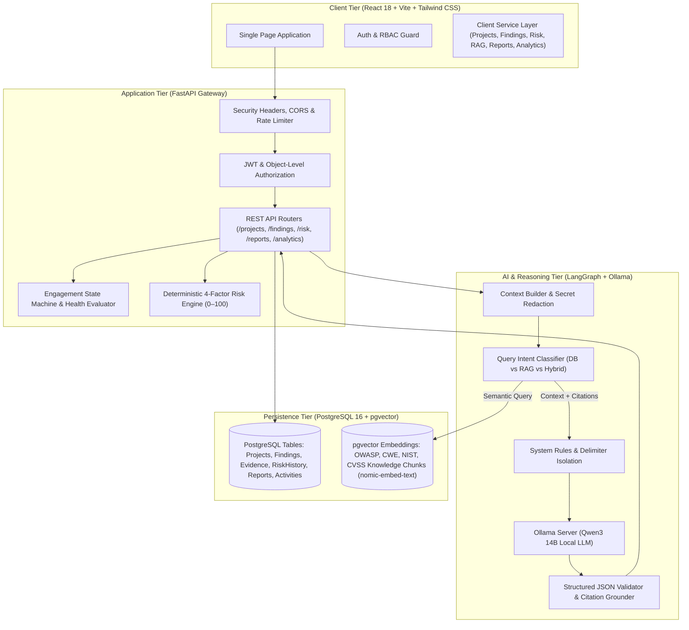
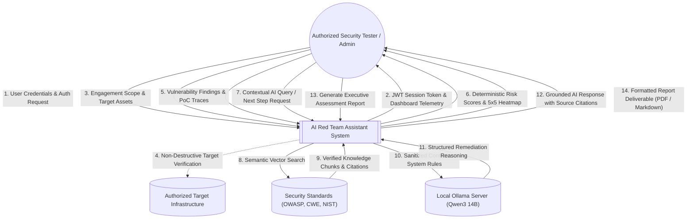
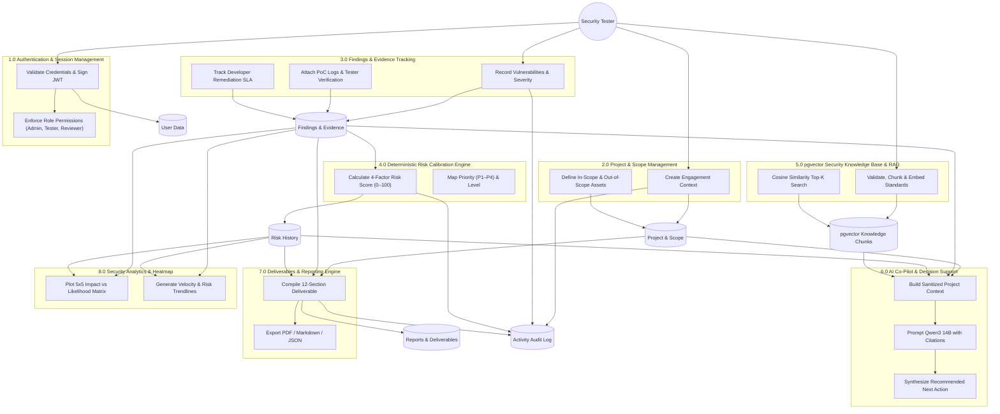
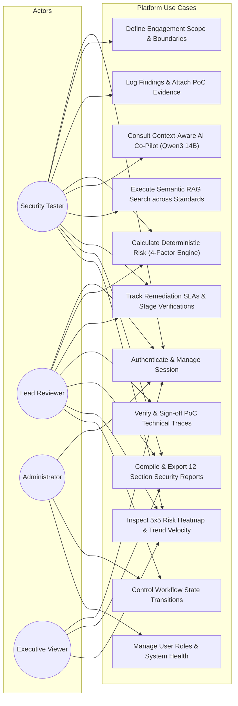
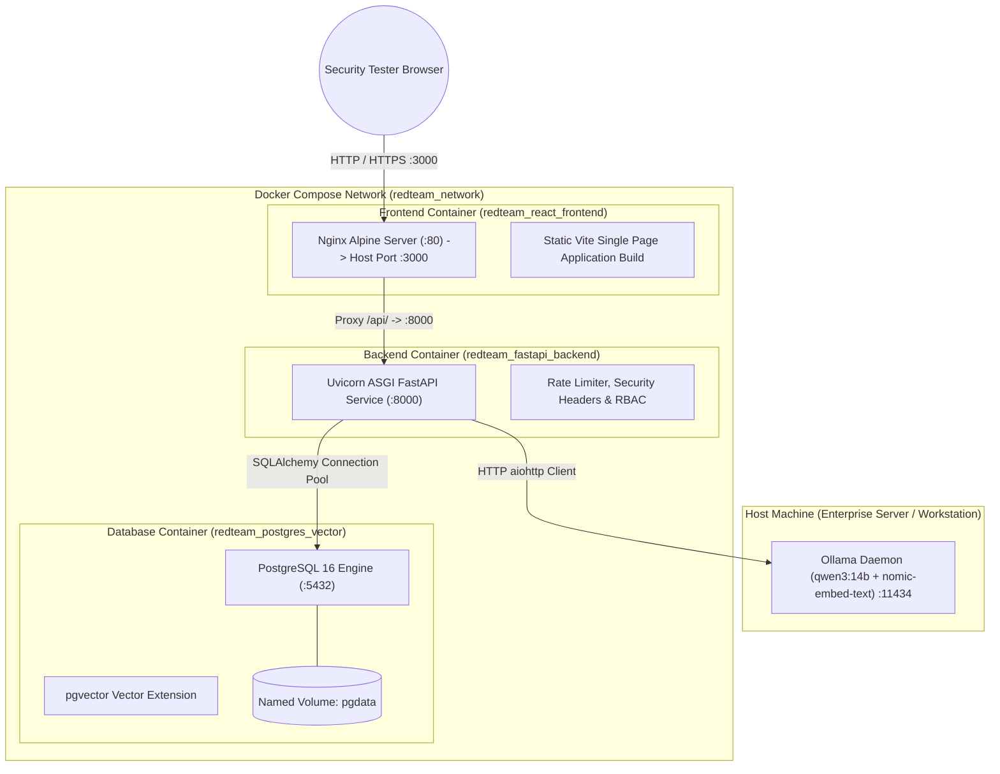

# AI Red Team Assistant — System Architecture & Design Specification

This document provides complete architectural specifications, data flow diagrams (DFD Level 0 & Level 1), entity-relationship (ER) models, use case representations, AI/RAG grounding workflows, and production deployment topologies for the **AI Red Team Assistant**.

---

## 1. High-Level System Architecture



---

## 2. Data Flow Diagram (DFD Level 0 — Context Diagram)



---

## 3. Data Flow Diagram (DFD Level 1 — Functional Decomposition)



---

## 4. Entity-Relationship (ER) Data Model

```mermaid
erDiagram
    USER ||--o{ PROJECT : "creates / leads"
    PROJECT ||--o{ SCOPE_ASSET : "contains"
    PROJECT ||--o{ FINDING : "contains"
    PROJECT ||--o{ REPORT : "generates"
    PROJECT ||--o{ WORKSPACE_ACTIVITY : "logs"
    
    FINDING ||--o{ EVIDENCE : "supported by"
    FINDING ||--|| RISK_ASSESSMENT : "evaluated by"
    FINDING ||--o{ REMEDIATION_RECORD : "tracked by"

    KNOWLEDGE_SOURCE ||--o{ KNOWLEDGE_DOCUMENT : "organizes"
    KNOWLEDGE_DOCUMENT ||--o{ KNOWLEDGE_CHUNK : "split into"

    USER {
        string id PK
        string email UK
        string password_hash
        string full_name
        string role "ADMIN | SECURITY_TESTER | REVIEWER | VIEWER"
        datetime created_at
    }

    PROJECT {
        string id PK
        string name
        string organization
        string project_type "WEB_APP | NETWORK | CLOUD | API"
        string status "ACTIVE | IN_PROGRESS | COMPLETED | ARCHIVED"
        string engagement_state "PLANNING | SCOPING | ASSESSMENT | ANALYSIS | REMEDIATION | REPORTING | COMPLETED"
        int progress "0 - 100"
        int risk_score "0 - 100"
        string lead_tester
        date start_date
        date end_date
    }

    SCOPE_ASSET {
        string id PK
        string project_id FK
        string asset_identifier "e.g. auth.apexfin.com"
        string asset_type "DOMAIN | IP_RANGE | REPO | ENDPOINT"
        string scope_status "IN_SCOPE | OUT_OF_SCOPE"
        string environment "PRODUCTION | STAGING | INTERNAL"
    }

    FINDING {
        string id PK
        string project_id FK
        string title
        string vulnerability_type "SQLi | XSS | SSRF | IDOR | AUTH"
        string severity "CRITICAL | HIGH | MEDIUM | LOW | INFORMATIONAL"
        int risk_score "0 - 100"
        string priority "P1 — Immediate | P2 — High | P3 — Normal | P4 — Low"
        string asset
        string endpoint
        string description
        string impact
        string recommendation
        string status "OPEN | REMEDIATION | RESOLVED | ACCEPTED_RISK"
        string remediation_status "NOT_STARTED | IN_PROGRESS | FIXED | VERIFIED | REJECTED"
        string assigned_user
        date due_date
        string resolution_notes
    }

    EVIDENCE {
        string id PK
        string finding_id FK
        string title
        string description
        string file_reference
        string verification_status "UNREVIEWED | REVIEWED | VERIFIED | REJECTED"
        string verified_by
        datetime verified_at
    }

    RISK_ASSESSMENT {
        string id PK
        string finding_id FK
        int impact "1 - 5 (35%)"
        int likelihood "1 - 5 (30%)"
        int asset_criticality "1 - 5 (20%)"
        int exploitability "1 - 5 (15%)"
        int calculated_score "0 - 100"
        string risk_level "CRITICAL | HIGH | MODERATE | LOW"
        string recommended_priority "P1 | P2 | P3 | P4"
        string justification
    }

    KNOWLEDGE_SOURCE {
        string id PK
        string name "OWASP Top 10 | MITRE CWE | NIST SP 800-115 | CVSS v3.1"
        string source_type "STANDARD | VULNERABILITY_DATABASE | GUIDANCE | METHODOLOGY"
        string version
        string status "INDEXED"
    }

    KNOWLEDGE_DOCUMENT {
        string id PK
        string source_id FK
        string title
        string content_hash "SHA-256 duplicate detection"
        string source_reference
    }

    KNOWLEDGE_CHUNK {
        string id PK
        string document_id FK
        string section
        string content
        vector embedding "768-dim nomic-embed-text vector"
        json metadata
    }

    REPORT {
        string id PK
        string project_id FK
        string title
        string report_type "EXECUTIVE | TECHNICAL | FULL_ASSESSMENT | REMEDIATION"
        string version "v1.0 | v1.1"
        string status "DRAFT | IN_REVIEW | READY | ARCHIVED"
        json sections_data
    }

    WORKSPACE_ACTIVITY {
        string id PK
        string project_id FK
        string entity_type "PROJECT | FINDING | RISK | EVIDENCE | REPORT"
        string entity_id
        string action "FINDING_CREATED | RISK_UPDATED | EVIDENCE_VERIFIED | REPORT_GENERATED"
        string description
        datetime created_at
    }
```



---

## 5. Use Case Diagram (Actors & Capabilities)



---

## 6. pgvector RAG Grounding Pipeline Architecture

```mermaid
flowchart LR
    subgraph Ingestion_Stage ["1. Knowledge Ingestion Pipeline"]
        Doc[Security Standard / Methodology Document] --> Validate[Validate & Compute SHA-256 Hash]
        Validate --> Clean[Text Normalization & Secret Redaction]
        Clean --> Chunk[Semantic Chunker (500 tokens / 50 overlap)]
        Chunk --> Embed[Ollama nomic-embed-text (768-dim)]
        Embed --> PGVector[(PostgreSQL pgvector Table)]
    end

    subgraph Query_Stage ["2. Intent Routing & Retrieval Pipeline"]
        UserQ[User Question / Finding Context] --> Router{RAG Query Router}
        Router -->|Project Context| DB[(Project DB)]
        Router -->|Security Standard / Remediation| VectorSearch[Cosine Similarity Search Top-K]
        VectorSearch --> PGVector
        PGVector --> RankedChunks[Ranked Relevant Chunks with Cosine %]
    end

    subgraph Grounding_Stage ["3. Prompt Construction & Output"]
        RankedChunks --> PromptAssembler[Assemble Prompt with Delimiters]
        DB --> PromptAssembler
        PromptAssembler --> QwenLLM[Local Ollama Qwen3 14B]
        QwenLLM --> Response[Structured AI Response + Verified Source Citations]
    end
```

---

## 7. Production Deployment Topology (Docker Compose)


